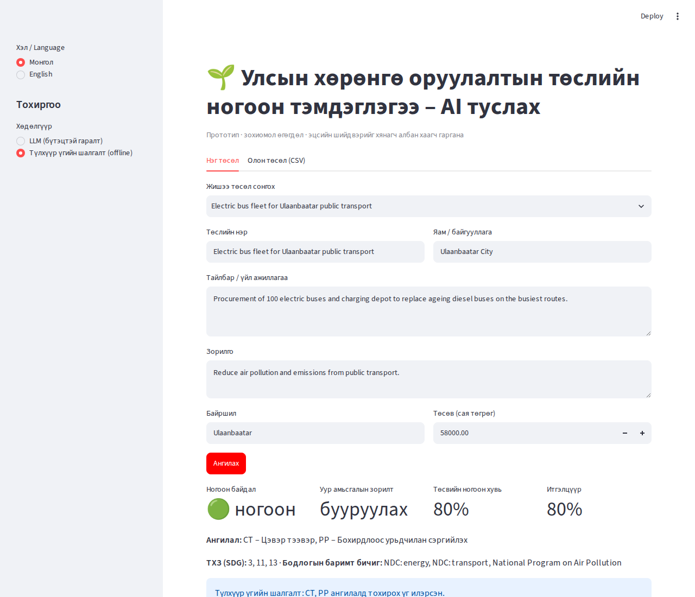

# AI-assisted green tagging of public investment projects (demo)

A small working prototype showing how a large language model (LLM) can help ministries
**screen public investment project proposals against green-tagging criteria** – the kind of
workflow used for green budget tagging in Mongolia (e.g. the green questionnaire attached to
budget proposals).

> **Status:** personal demonstration prototype. All project data in `data/` is **synthetic**.
> The criteria in `greentag/taxonomy.py` are **illustrative**, adapted from the structure of the
> Mongolia Green Taxonomy (2019) and common climate budget tagging practice; a real deployment
> would load the official Ministry of Finance criteria instead.



## What it does

For each proposal (Mongolian or English) it returns a **schema-validated structured result**:

| Field | Meaning |
|---|---|
| `green_relevance` | `green` · `partially_green` · `not_green` · `harmful` |
| `climate_objective` | `mitigation` · `adaptation` · `both` · `none` |
| `taxonomy_categories` | e.g. `RE` renewable energy, `EE` energy efficiency, `AD` adaptation … |
| `sdg_goals`, `frameworks` | links to SDGs and national frameworks (NDC, NAP, NBSAP, Vision 2050) |
| `green_share_pct` | estimated green share of the budget |
| `rationale`, `evidence` | plain-language explanation (English or Mongolian) + verbatim quotes |
| `confidence`, `needs_human_review` | routes uncertain or mixed cases to an officer |

The AI **suggests**; the reviewing officer decides.

## Architecture

```
proposal (form / CSV) ──► ProjectProposal (pydantic)
                              │
             ┌────────────────┴────────────────┐
             ▼                                 ▼
   LLM backend (llm_tagger.py)       keyword baseline (rule_tagger.py)
   criteria injected into prompt      offline, no API key needed
   forced tool call / JSON mode
             │                                 │
             └──────────► GreenTag (validated JSON) ◄──┘
                              │
          Streamlit UI (app.py) · CLI (tag_cli.py) · benchmark (evaluate.py)
```

* **Structured output:** with Anthropic the model must call a `record_green_tag` tool whose
  `input_schema` is generated from the `GreenTag` pydantic model; with OpenAI JSON mode is used.
  Every answer is validated by pydantic before it is shown.
* **Provider-agnostic:** `GREENTAG_PROVIDER=anthropic|openai|ollama`, optional `GREENTAG_MODEL`.
* **Local / on-premise option:** with `ollama` the model runs on the user's own machine (e.g.
  `qwen2.5:7b` on an 8 GB GPU); no API key, no cost, and proposal data never leaves the
  government network – relevant for sensitive budget documents. The JSON schema is passed to
  Ollama's `format` parameter so even small local models return valid structured output.
* **Benchmarking:** `evaluate.py` compares any backend with manually assigned labels.

## Run it

```bash
pip install -r requirements.txt
cp .env.example .env        # add ANTHROPIC_API_KEY or OPENAI_API_KEY (optional)
streamlit run app.py        # web UI – single proposal or batch CSV upload
python -m greentag.evaluate --backend rules   # benchmark offline baseline
python -m greentag.evaluate --backend llm     # benchmark the LLM (needs a key)
python tag_cli.py data/sample_projects.csv --backend auto > results/tags.jsonl
pytest -q
```

Without an API key the app falls back to the keyword baseline automatically.

### Free local model (Ollama)

```bash
# 1. install Ollama from https://ollama.com and start it
ollama pull qwen2.5:7b
# 2. in .env
GREENTAG_PROVIDER=ollama
# 3. run as above
python -m greentag.evaluate --backend llm
streamlit run app.py
```

## Results (16 synthetic proposals)

| Engine | Green relevance correct | Climate objective correct | Category F1 | Report |
|---|---|---|---|---|
| Keyword baseline | 14/16 (88 %)* | 94 % | 0.97* | `results/evaluation_rules.md` |
| qwen3:8b local, v1 prompt | 11/16 (69 %) | 50 % | 0.51 | `results/evaluation_llm_qwen3-8b_v1.md` |
| qwen3:8b local, v2 prompt + consistency rules | **14/16 (88 %)** | **94 %** | 0.74 | `results/evaluation_llm_ollama_qwen3-8b.md` |

\* The baseline keywords and the sample were written by the same author, so its scores are inflated.

**What changed between v1 and v2.** Error analysis of v1 showed four patterns: ordinary schools, roads
and offices tagged "partially green"; a coal-mine railway not recognised as harmful; a coal plant tagged
harmful *and* given all ten green categories; climate objectives inconsistent with the categories.
v2 adds (a) explicit tagging principles to the prompt (default `not_green`; fossil-fuel infrastructure is
`harmful`) and (b) deterministic consistency rules applied after the model (`enforce_consistency`):
no categories for not-green/harmful projects, objective derived from the categories, harmful projects
always go to human review.

**Remaining errors (v2).** P02 (improved stoves + insulation, Mongolian text) tagged partially green
instead of green; P10 ("Green Development Tower" office block) still tagged partially green – the model is
partly misled by the green label. Category recall (0.67) is lower because the model usually gives only the
main category.

**Caveat.** v2 was tuned after seeing v1's errors on the same 16 proposals, so its numbers are
optimistic. A real evaluation needs a separate set of proposals tagged by Ministry of Finance staff.
The 8B local model's Mongolian explanations are also weaker than its English ones; a larger model
or the Claude API gives better Mongolian text.

## Why an LLM and not keywords?

The keyword baseline's two errors illustrate why a keyword approach does not generalise:

* **P04** – a dormitory where only ~20 % of the budget is solar/insulation is tagged fully
  `green`; keywords cannot weigh the *share* of green activity.
* **P14** – a hospital renovation is tagged renewable energy because "**wind**ows" contains
  "wind".

The LLM backend is instructed to judge substance, estimate the green share, catch
"green-washing" titles (see P10 "Green Development Tower") and quote its evidence.
A proper evaluation would use proposals already tagged by Ministry of Finance staff.

## Next steps for a real deployment

1. Replace the illustrative criteria with the official green-tagging methodology and load the
   actual green questionnaire responses.
2. Build a labelled evaluation set with MoF/MED reviewers; track agreement and review rate.
3. Host inside government infrastructure or a data-protection-compliant cloud; log every
   AI suggestion and officer decision for audit.
4. Add retrieval over NDC/NAP/NBSAP texts so rationales can cite specific targets.

## Layout

```
greentag/        taxonomy.py · schema.py · llm_tagger.py · rule_tagger.py · tagger.py · evaluate.py
data/            sample_projects.csv (synthetic, with reference labels)
results/         evaluation reports
app.py           Streamlit UI
tag_cli.py       batch command line
tests/           pytest (includes a mocked LLM call)
```

Author: Enkhbayar Sundui · MIT License
